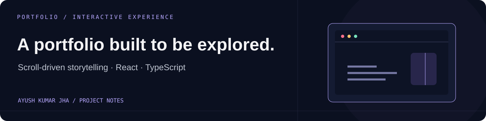

# Interactive Portfolio
### Ayush Kumar Jha · React edition

[Open this version](https://ayush-kumar-jha.onrender.com/) · [Current portfolio](https://ayush-kumar-jha-v2.onrender.com/)

An earlier portfolio built around scroll-driven portrait chapters, X-ray hover effects, project sections, and downloadable credentials.

**React · TypeScript · Vite · CSS**

This repository preserves the React edition. The newer static portfolio lives in [profile-2.0](https://github.com/AyushKJha/profile-2.0).

## Run locally

Use Node.js 22.13+:

```sh
git clone https://github.com/AyushKJha/ayush-portfolio.git
cd ayush-portfolio
npm install
npm run dev
```

Vite opens `/source.html`, the development entry.

## Source map

| File | Purpose |
| --- | --- |
| [Portfolio.tsx](Portfolio.tsx) | Content, portrait interaction, and scroll behavior |
| [portfolio.css](portfolio.css) | Layout, typography, and animation |
| [main.tsx](main.tsx) / [source.html](source.html) | Development entry |
| [vite.config.ts](vite.config.ts) | Build configuration |
| [finish-build.mjs](finish-build.mjs) | Output preparation and asset copying |

## Build and publish

```sh
npm run build
npm run preview
```

Publish `dist/` on a static host. The existing Render setup serves previously built files from the repository root; changing the source alone does not refresh that bundle. To deploy source changes, publish the new `dist/` output or configure Render to build and serve it.

The root source is the editable project. `portfolio-source.zip` is an earlier scaffold backup. No API keys are required.
